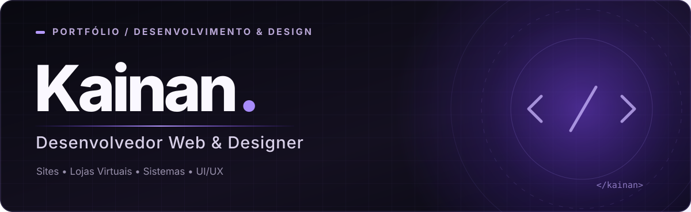
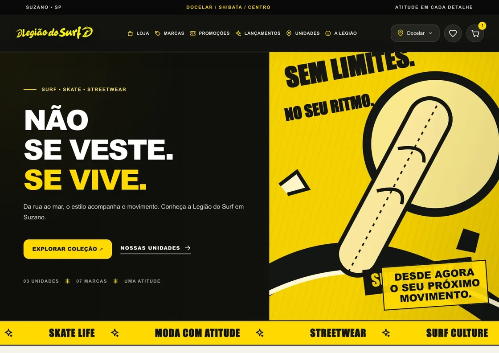

  
    
  
  

👋 Sobre mim
Sou Kainan Júnior, Desenvolvedor Web & Designer. Trabalho na criação de experiências digitais para empreendedores e empresas que precisam de uma presença profissional na internet.

Gosto de unir identidade visual, usabilidade e desenvolvimento para transformar ideias em sites, lojas virtuais e sistemas personalizados.
Minha proposta: soluções digitais que valorizam a identidade de cada negócio — do primeiro contato à experiência final.

✦ O que desenvolvo
- Sites profissionais — páginas institucionais, landing pages e portfólios.
- Lojas virtuais — vitrines digitais e experiências de compra.
- Sistemas personalizados — ferramentas web e painéis administrativos conforme a necessidade de cada projeto.
- UI/UX Design — interfaces com atenção à navegação, à clareza e à apresentação visual.
🛠️ Tecnologias e ferramentas

  
  
  
  
  
  
  

🚀 Projetos selecionados
Uma seleção de interfaces e soluções que estou desenvolvendo. As imagens abaixo são capturas de apresentações dos próprios projetos.
<table>
  <tr>
    <td width="50%" valign="top">
      
      <h3>🏄 Legião do Surf</h3>
      
Plataforma digital para moda surf, skate e streetwear, com apresentação de produtos, marcas e unidades.

      
<strong>Status:</strong> 🚧 Em desenvolvimento

    </td>
    <td width="50%" valign="top">
      
      <h3>📱 TCell Smart</h3>
      
Experiência digital para assistência técnica, com catálogo de serviços e interface de acompanhamento de reparos.

      
<strong>Status:</strong> 🚧 Em desenvolvimento

    </td>
  </tr>
  <tr>
    <td width="50%" valign="top">
      
      <h3>✦ Studio Hary</h3>
      
Site para o segmento de beleza, com serviços, portfólio visual e formulário de solicitação de agendamento.

      
<strong>Status:</strong> 🚧 Em desenvolvimento

    </td>
    <td width="50%" valign="top">
      <h3>💜 Próximos projetos</h3>
      
Novas experiências digitais serão adicionadas conforme avançarem.

      
Meu foco é construir interfaces que combinam identidade, praticidade e propósito.

      
<a href="https://github.com/KainanJunior?tab=repositories">Explorar repositórios →</a>

    </td>
  </tr>
</table>

🤝 Vamos criar algo juntos?
Tenho interesse em colaborar com empreendedores e empresas de diferentes portes, em todo o Brasil. Se você procura um site, uma loja virtual, um sistema personalizado ou uma interface melhor para seu negócio, vamos conversar.

  <a href="https://github.com/KainanJunior">GitHub: @KainanJunior</a>
    
  Feito com atenção aos detalhes · Kainan Júnior

